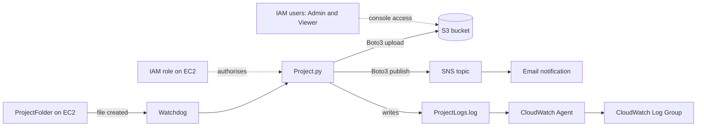

# Automated Cloud Backup and Monitoring System on AWS

An automated backup and monitoring system built on AWS. A Python application running on an EC2 instance watches a folder, uploads every new file to Amazon S3, sends an email through Amazon SNS to confirm the backup, and streams its activity log to Amazon CloudWatch for central monitoring. Access is controlled with IAM, using an instance role for the application and separate Admin and Viewer users for the console.

## Aim

To design and implement an automated cloud-based backup and monitoring system on AWS that detects newly created files on an EC2 instance, uploads them to S3, sends email notifications through SNS, and monitors logs centrally through CloudWatch, with access controlled through IAM.

## Architecture



## Features

- Automatic detection of new files using Watchdog filesystem events.
- Automatic upload of each detected file to an S3 bucket using Boto3.
- Email confirmation through an SNS topic after every successful upload.
- Every event written to `ProjectLogs.log` and streamed to CloudWatch in near real time.
- No access keys in the code: credentials come from an IAM role attached to the EC2 instance.
- Role-based access control demonstrated with an Admin user and a view-only Viewer user.

## AWS Services and Resources

| Service    | Resource                       | Role                                          |
|------------|--------------------------------|-----------------------------------------------|
| EC2        | Linux instance (Amazon Linux 2023, t3.micro) | Hosts the monitoring application |
| S3         | Bucket `abcnewaws`             | Durable storage for backed-up files           |
| SNS        | Topic `ProjectNotification`    | Sends the backup confirmation email           |
| CloudWatch | Log group `ProjectLogs`        | Central log monitoring                        |
| IAM        | Instance role                  | Lets the application call S3, SNS and CloudWatch |
| IAM        | Users `Admin` and `Viewer`     | Demonstrate role-based console access         |

Region: Asia Pacific (Mumbai), `ap-south-1`.

## How It Works

1. `Project.py` starts and begins watching `/home/ec2-user/ProjectFolder`.
2. When a new file appears, Watchdog raises a created event and the application logs it.
3. After a short 2 second wait so the file finishes writing, the file is uploaded to the S3 bucket with Boto3.
4. On success, the application publishes a message to the SNS topic, and the subscribed address receives a "Backup Successful" email with the file name, bucket and time.
5. Every step is written to `ProjectLogs.log`. The CloudWatch Agent ships this file to the `ProjectLogs` log group, where each EC2 instance appears as a log stream.

Example log output:

```
2026-08-26 18:39:01,166 - INFO - Cloud Backup System Started
2026-08-26 18:39:43,987 - INFO - New file detected : /home/ec2-user/ProjectFolder/ProjectDemo.txt
2026-08-26 18:39:45,300 - INFO - ProjectDemo.txt uploaded successfully.
2026-08-26 18:39:45,800 - INFO - SNS notification sent for ProjectDemo.txt
```

## IAM Access Control

| Identity        | Access                                   | Observed behaviour                              |
|-----------------|------------------------------------------|-------------------------------------------------|
| EC2 instance role | S3, SNS and CloudWatch permissions     | Application runs without any stored access keys |
| Admin user      | Full S3 access                           | Can upload and manage objects in the bucket     |
| Viewer user     | View only                                | Upload and delete in S3 fail with Access Denied |

## Setup

1. Launch a Linux EC2 instance and attach an IAM role that allows the application to use S3, SNS and CloudWatch Logs.
2. Create an S3 bucket (names are globally unique, so choose your own and update `BUCKET_NAME`).
3. Create an SNS topic named `ProjectNotification`, subscribe an email address and confirm the subscription. Copy the topic ARN into `SNS_TOPIC_ARN`.
4. Connect to the instance over SSH and create the watched folder:

   ```
   mkdir ~/ProjectFolder
   ```

5. Install the dependencies (Python 3.10 or later is recommended, see the note below):

   ```
   pip3 install -r requirements.txt
   ```

6. Install the CloudWatch Agent, copy `config/cloudwatch-agent-config.json` to the agent config location and start the agent:

   ```
   sudo dnf install -y amazon-cloudwatch-agent
   sudo cp config/cloudwatch-agent-config.json /opt/aws/amazon-cloudwatch-agent/etc/amazon-cloudwatch-agent.json
   sudo /opt/aws/amazon-cloudwatch-agent/bin/amazon-cloudwatch-agent-ctl -a fetch-config -m ec2 -c file:/opt/aws/amazon-cloudwatch-agent/etc/amazon-cloudwatch-agent.json -s
   ```

7. Create the IAM users `Admin` and `Viewer` with different permission policies.

## Run and Test

1. Start the application:

   ```
   python3 src/Project.py
   ```

2. In a second SSH session, create a test file:

   ```
   echo "This is my Cloud Backup Project Demo" > ~/ProjectFolder/ProjectDemo.txt
   ```

3. Verify the full flow: the console prints the detection and upload messages, the file appears in the S3 bucket, a confirmation email arrives, and the log events appear in the `ProjectLogs` log group in CloudWatch.
4. Sign in as the Viewer user and confirm that uploading or deleting objects in the bucket is denied.

## Results

Creating a new file in `ProjectFolder` triggered automatic detection, upload to the S3 bucket, a confirmation email through SNS, and log entries that appeared in the CloudWatch log group. The Admin user could manage bucket objects, while the Viewer user received Access Denied on upload and delete attempts.

## Future Scope

- Least-privilege IAM policies scoped to the specific bucket, topic and log group
- Run the application as a systemd service so it restarts automatically
- Upload files from subfolders and handle large files reliably
- CloudWatch alarms for upload failures
- S3 versioning and lifecycle rules for backup retention
- Infrastructure as code with CloudFormation or Terraform
